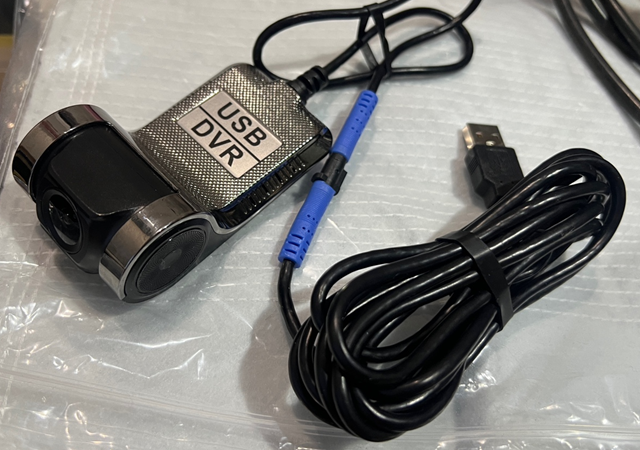

<h1 align="center">uCarDvr-PyWin</h1>

<p align="center">
  <a href="README.md">English</a> |
  <a href="README.ko.md">한국어</a>
</p>

# uCarDvr USB 카메라 → Windows용 소프트웨어 도구 모음



Android 올인원 호환 "자동차 앞유리 부착용" USB 카메라(uCarDvr.apk 전용 SW 제공, Generalplus
SoC)를 Windows PC에 연결하여 **실시간 뷰어 및 녹화 + SD 녹화 파일 탐색·재생·다운로드**하기 위한
소프트웨어 도구 모음.

아마 시장에 다양한 변종 모델들이 있을 것이지만, 2020년에 알리익스프레스에서 구매한 나의 카메라를 기준으로 개발 및 테스트함.

## 빠른 시작

```
pip install -r requirements.txt
python xufs_player.py                        # 통합 GUI
```
실행 시 관리자 권한이 필요함. 권한이 없으면 경고가 뜨고 **관리자 모드 재실행**을 제안한다 — 카메라 명령은
물리 디스크(`\.\PhysicalDriveN`) 직접 접근이라 권한이 없으면 카메라를 찾지 못한다.

- **[라이브 뷰] 탭**: 실행하면 라이브가 자동 시작된다(카메라는 녹화 중일 때만 스트리밍에
  응답하므로 라이브 = 항상 녹화 병행). 📸 스냅샷(PC에 프레임 저장) / ⏺ 로컬 녹화(PC에 AVI 저장) /
  화면 하단 안내: **라이브 뷰는 소리가 나지 않는다** (펌웨어 설계 — 녹화 파일에서 확인 가능)
- **[녹화 탐색] 탭**: SD 파일 목록(`🔒/📷 NNNN + 촬영일시`, **헤더 클릭으로 정렬 전환**) /
  갱신·🗑삭제·🔒보호 → ▶ 재생: 영상 + **소리 출력**, 볼륨, 일시정지·이전·다음,
  **다음파일 자동재생 체크박스**(재생 실패 시에도 다음 파일로 진행),
  **반복 토글(없음→한 파일→전체 순환)**,
  **재생 위치 슬라이더**(길이 조회 성공 시 표시) /
  📥선택·📦전체 다운로드(진행창+취소, 저장물은 **오디오 포함 단일 .avi**)
- 프로그램 종료 시 확인창에서 "예"를 누르면 카메라에 녹화 재개(cmd 1)를 보내고 닫는다 —
  종료 후 카메라는 전원 ON 시와 같은 상시 녹화 상태로 남는다.

**오디오**: 파일 재생 시 응답 채널(cmd 0x21)로 32kHz 모노 16비트 PCM이 스트리밍된다 —
앱 내 재생에서 소리로 출력된다. 마이크가 있고 녹화 파일에 소리가 들어있다.
하지만 라이브 뷰는 펌웨어가 이 채널을 보내지 않아 설계상 무음 — 카메라·호스트 앱의 동작 관찰상
라이브 오디오 활성화 명령은 확인되지 않는다(녹화 시작 = cmd 12 → cmd 1 뿐, 마이크는 cmd 13
토글뿐).

## 이 저렴한 카메라가 특별대우를 받지 못한 이유

UVC 웹캠이 아니라 **USB 대용량 저장장치**로만 동작한다(그래서 Windows가 카메라로 못 잡음).
루트의 `elen1`(307,200바이트) 파일이 호스트↔펌웨어 사서함이며, 명령은 elen1의 오프셋
0x3E800에서 **read 크기에 니블 인코딩**된 SCSI READ(10) 패턴으로 전송하고, 영상은 펌웨어가
elen1 섹터 0에 기록하는 **모션 JPEG(1280×720)** 를 폴링해 받는다. 상세한 프로토콜은
[PROTOCOL.md](PROTOCOL.md) 참고.

(특별대우는 못 받지만, 굴러다니는 USB-A 휴대폰 충전 어댑터를 쓰고, SD카드를 직접 꽂아서 녹화하는 간단한 감시 카메라 용도로는, 
 좋은 대우를 해줄 만 했습니다!)

## 파일 구성

| 파일 | 용도 |
|---|---|
| `xufs_lib.py` | 공통 라이브러리 — elen1 탐색, FAT LCN→LBA 매핑, SCSI READ(10) 패스스루, 니블 신호, 프레임/응답 파싱, 재생 스트림 캡처, MJPEG AVI 작성(오디오 뮥싱 포함) |
| `xufs_player.py` | **통합 GUI** — 탭 1 [라이브 뷰]: 실시간 화면·스냅샷·로컬 녹화 / 탭 2 [녹화 탐색]: SD 목록(정렬)·재생(소리·볼륨·시크·반복·자동재생)·삭제·보호·다운로드 |
| `xufs_probe.py` | 진단 도구 — BPB/루트 덴트리 검증, 전체 명령 시퀀스, 광역 변화 감시 (`--scsi`) |
| `PROTOCOL.ko.md` | 한국어 프로토콜 명세 (실측 검증 기반.) |

오디오 출력은 Windows 내장 API(winmm waveOut)를 직접 사용 — 재생에 필요한 패키지는 `opencv-python`과 `numpy`뿐이다.

## 사용 순서

1. **진단**: `python xufs_probe.py --scsi` — 부트섹터 BPB, 루트 디렉터리, 명령 반응 확인
2. **통합 GUI**: `python xufs_player.py` (관리자 권한)
   - **[라이브 뷰] 탭**: 시작하면 라이브 자동 시작(=카메라 녹화 병행, 실시간 화면) /
     📸 스냅샷 / ⏺ 로컬 녹화(AVI로 저장) / 하단에 라이브 무음 안내 문구
   - **[녹화 탐색] 탭**: 좌측 SD 파일 목록 — `🔒/📷 NNNN yy-MM-dd HH:MM:SS` 형식
     (🔒 = 잠금 파일, 📷 = 사진), **번호·촬영일시 헤더 클릭으로 정렬 전환(▼/▲)** /
     갱신·🗑삭제·🔒보호 → ▶ 재생 (소리·볼륨·일시정지·이전·다음 / 하단 좌측에
     자동재생·반복 토글) / 📥선택저장·📦전체저장
     (저장 위치 선택 → 진행창+취소 / 저장물은 오디오가 들어있는 단일 .avi)
   - 재생 중 파일이 끝나면: 반복 "한 파일"→같은 파일, "전체"→다음(끝에서 처음으로),
     "없음"+자동재생 체크→다음(끝에서 정지), 그 외 정지. 재생 파일에 목록 선택이 따라간다
   - 두 탭은 메일박스 단일 채널을 공유 — 탭 전환 시 이전 동작이 자동 정리된다
     (라이브 → 탐색 전환 시 녹화가 정지된다)

참고: 내부 플래시에는 펌웨어와 elen1/zlog뿐이며 사용자 녹화물은 SD카드에만 기록된다.
**SD카드는 Windows에 드라이브로 노출되지 않는다** — 프로토콜(§9)로만 접근 가능.
SD 삽입 + 전원 ON 시 자동 루프 녹화가 시작되며, GUI가 시작 시 자동으로 정지한다.
카메라 전원을 끄면 RTC가 초기화되므로 재연결 시 시각 동기화가 다시 수행된다.

## 문제 해결 (실제로 다 겪어본 것들)

| 증상 | 원인 / 해결 |
|---|---|
| SPTD 오류 5 (액세스 거부) | 볼륨 핸들이거나 읽기 전용 핸들. `\\.\PhysicalDriveN`을 **읽기+쓰기**로 열 것 |
| SPTD 오류 6 (핸들 잘못됨) | 64KB 초과 단일 전송 / 버퍼 미정렬. 32KB 이하 + 4096 정렬 |
| 명령을 보내도 무반응 | LBA 3중 보정 확인: LCN은 **데이터영역 기준 상대값**, +MBR 파티션 223, +파일 오프셋 |
| `Corrupt JPEG data: N extraneous bytes before marker 0xd9` | 카메라 인코더 특성(고정 버퍼 패딩 추정 — PROTOCOL.md §5). 화질 무관. 앱이 첫 EOI truncate로 처리 |
| 실행 중 카메라 연결 끊김 | 앱이 오류 팝업을 띄우고 [🔁 재연결] 버튼이 활성화된다. 재연결이 계속 실패하면 카메라를 재꽂아야 할 수 있다 (녹화 중단 상태로 전원이 유지되면 스트리밍이 영구 중단됨 — PROTOCOL.md §5) |
| 재생 파일 전환 시 "재생 시작 실패" | 직전 재생 직후의 빠른 전환 시 펌웨어가 새 재생을 무시할 수 있음 — 한 번 더 누르면 된다 (앱이 자동 복구하고 안내 표시) |
| OpenCV imdecode 오류 | OpenCV 5.0은 numpy 배열만 허용 — `np.frombuffer` 사용 |
| `bytes must be in range` | cmd 19 payload의 연도는 `year-2000` (2000년 기준 2자리) |
| 재생 위치 슬라이더가 안 보임 | 정상 — 펌웨어가 cmd 57(길이 조회)에 응답하지 않는 것이 실측으로 확정되어(37회 이상 시도, 다양한 상태·arg 형식) 기능을 제공하지 않는다 |

## 요구 사항

- Windows (xufs_lib의 SPTD/파일시스템 계층이 Win32 전용), Python 3.10+
- `opencv-python`, `numpy`, 관리자 권한 cmd (SCSI 패스스루). 오디오 출력은 Windows 내장 API 사용 — 추가 패키지 없음
- 카메라는 자동으로 드라이브 문자로 마운트되어야 함 (탐색기에 표시되면 OK)
