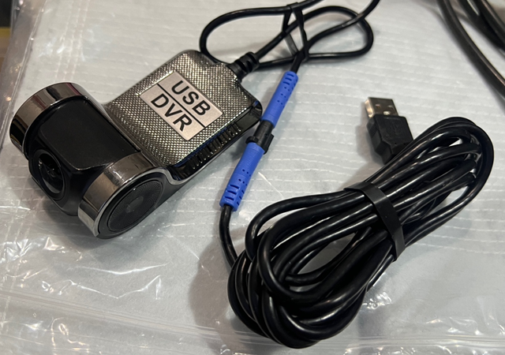

<h1 align="center">uCarDvr-PyWin</h1>

<p align="center">
  <a href="README.md">English</a> |
  <a href="README.ko.md">한국어</a>
</p>



A software toolset designed to connect Android Head Unit compatible "windshield-mount" USB cameras (provided with `uCarDvr.apk`, Generalplus SoC) to a Windows PC. It enables **real-time live viewing and recording + SD card file browsing, playback, and downloading** on your PC.

While various clone models exist in the market, this was developed and tested based on a camera I purchased from AliExpress in 2020.

## Quick Start

```bash
pip install -r requirements.txt
python xufs_player.py                        # Integrated GUI
```

Requires Administrator privileges - If not, a warning prompts you to **restart in Administrator mode**. Camera commands rely on direct physical disk access (`\\.\PhysicalDriveN`), which cannot locate the camera without permissions.

- **[Live View] Tab**: Live streaming starts automatically upon execution (Since the camera only responds to streams while recording, Live = Simultaneous Recording). 📸 Snapshot (Saves frame to PC) / ⏺ Local Record (Saves AVI to PC). Bottom notice: **Live view is muted** (Firmware design constraint — audio is available in recorded files).
- **[Recording Explorer] Tab**: SD file list (`🔒/📷 NNNN + Date/Time`, **Click headers to sort**) / Refresh · 🗑Delete · 🔒Protect. ▶ Playback: Video + **Audio output**, Volume, Pause, Prev/Next. **Auto-play next file checkbox** (Proceeds to the next file even on failure). **Loop toggle (None → One File → All)**. **Playback Seek Slider** (Visible if length query succeeds). 📥Select · 📦Bulk Download (Progress bar + Cancel; outputs as **single .avi files with audio**).
- Upon closing the program and confirming "Yes", it sends a resume recording command (cmd 1) to the camera before exiting — returning it to the standard continuous recording state.

**Audio**: During file playback, 32kHz Mono 16-bit PCM streams via the response channel (cmd 0x21) — outputting sound through the app. The microphone is functional, and recorded files contain audio. However, live view is muted by firmware design, as the camera/host app behaviors show no live-audio activation commands.

## Why This Cheap Camera Didn't Get Special Treatment

It operates strictly as a **USB Mass Storage Device**, NOT a UVC webcam (which is why Windows cannot recognize it as a camera). The `elen1` file (307,200 bytes) at the root acts as the host↔firmware mailbox. Commands are transmitted by injecting **nibble-encoded SCSI READ(10)** patterns into read sizes at offset 0x3E800, and video is received by polling **Motion JPEG (1280x720)** frames written by the firmware at sector 0. For detailed protocol specs, refer to [PROTOCOL.md](PROTOCOL.md).

*(Though it doesn't get standard treatment, it's decent enough to be repurposed as a simple surveillance camera using a spare USB-A phone charger and a direct SD card insertion!)*

## File Structure

| File | Purpose |
|---|---|
| `xufs_lib.py` | Common Library — elen1 scanning, FAT LCN→LBA mapping, SCSI READ(10) pass-through, nibble signaling, frame/response parsing, playback stream capture, MJPEG AVI generation (including audio muxing). |
| `xufs_player.py` | **Integrated GUI** — Tab 1 [Live View]: Real-time screen, snapshot, local record. / Tab 2 [Explorer]: SD list (sorting), playback (audio, volume, seek, loop, auto-play), delete, protect, download. |
| `xufs_probe.py` | Diagnostic Tool — BPB/Root dentry validation, full command sequence, global change monitoring (`--scsi`). |
| `PROTOCOL.md` | Protocol Specification (Based on empirical verification). |

Audio output uses the built-in Windows API (winmm waveOut) — `opencv-python` and `numpy` are the only external packages required for playback.

## Usage Sequence

1. **Diagnostics**: `python xufs_probe.py --scsi` — Verify Boot Sector BPB, Root Directory, and command responses.
2. **Integrated GUI**: `python xufs_player.py` (Administrator required).
   - **[Live View] Tab**: Live automatically starts (= Camera records concurrently). 📸 Snapshot / ⏺ Local Record (Saves as AVI) / Live mute notice at the bottom.
   - **[Recording Explorer] Tab**: Left SD list — `🔒/📷 NNNN yy-MM-dd HH:MM:SS` format (🔒 = Locked, 📷 = Photo). **Click number/date headers to sort (▼/▲)**. Refresh, 🗑Delete, 🔒Protect → ▶ Playback (Audio, Volume, Pause, Prev/Next, Auto-play, Loop toggles). 📥Save Selected · 📦Save All (Select directory → Progress bar; outputs as single audio-muxed .avi).
   - End of file playback behavior: Loop "One File" → repeats; "All" → next (wraps around); "None" + Auto-play checked → next (stops at end). The list selection follows the playing file.
   - Both tabs share a single mailbox channel — prior operations are auto-cleaned during tab switching (Live recording stops when switching to Explorer).

Note: The internal flash only contains firmware and elen1/zlog. User recordings are exclusively on the SD card. **The SD card is NOT exposed as a drive to Windows** — access is protocol-only (§9). Auto loop recording begins on SD insertion + Power ON; the GUI automatically stops it upon launch. Camera power-off resets the RTC, triggering a time sync upon reconnection.

## Troubleshooting (Things I actually went through)

| Symptom | Cause / Solution |
|---|---|
| SPTD Error 5 (Access Denied) | Using a volume handle or read-only handle. Open `\\.\PhysicalDriveN` with **Read+Write** access. |
| SPTD Error 6 (Invalid Handle) | Single transfer exceeds 64KB or buffer misaligned. Keep under 32KB + 4096-byte alignment. |
| No response to commands | Verify 3-tier LBA compensation: LCN is **relative to the data region**, + MBR partition 223, + Intra-file offset. |
| `Corrupt JPEG data: N extraneous bytes before marker 0xd9` | Camera encoder characteristic (Presumed fixed buffer padding — PROTOCOL.md §5). No impact on quality. App handles via first-EOI truncation. |
| Camera disconnects during execution | App throws an error popup and enables [🔁 Reconnect]. If reconnect keeps failing, unplug and replug the camera. (Power maintained during stopped recording permanently halts streams — PROTOCOL.md §5). |
| "Playback Start Failed" on fast switching | Rapid transitions may cause the firmware to ignore new playback requests. The app auto-recovers and displays a notice. |
| OpenCV imdecode error | OpenCV 5.0 strictly requires numpy arrays — use `np.frombuffer`. |
| `bytes must be in range` | The year for cmd 19 payload must be `year-2000` (2-digit relative to 2000). |
| Playback Seek Slider is missing | Normal — Empirically confirmed that the firmware does not respond to cmd 57 (length query) across 37+ attempts, hence the feature is disabled. |

## Requirements

- Windows (SPTD/Filesystem layers in `xufs_lib` are Win32 specific), Python 3.10+
- `opencv-python`, `numpy`, Administrator Command Prompt (SCSI Pass-through). Audio output uses native Windows API — no extra packages needed.
- The camera must be automatically mounted with a drive letter (Visible in Explorer = OK).